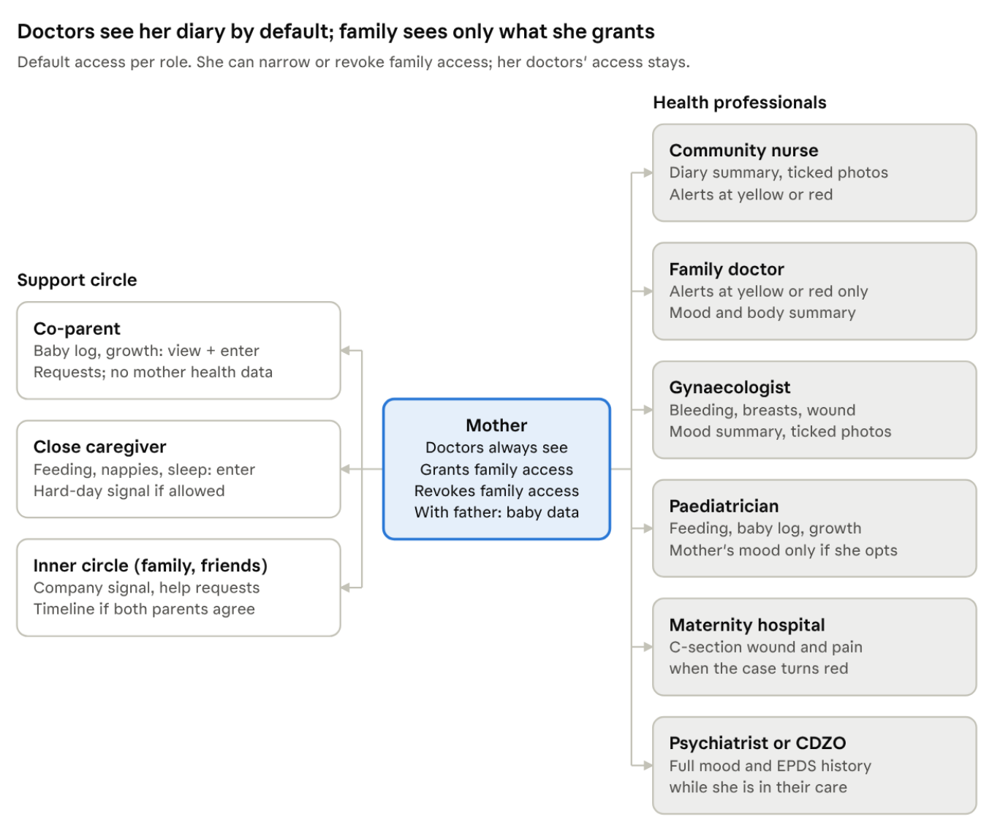

# zVEM+ Po porodu

**SANshine · AdaHack 2026**

This is an extension to zVEM and zVEM+. The mother logs how she and her baby are doing; the app sorts each case into green, yellow or red and brings the right professional in at the right time. She decides which family and friends see what.

**Try it:** open [`index.html`](index.html) in a browser. It is a single self-contained page; no build or server needed. Use the bar at the top to switch between Ana (the mother), Luka (her partner), the care team in zVEM+ and the paediatrician, and to move the clock.

Full write-up as a PDF: [`docs/READ_ME.pdf`](docs/READ_ME.pdf)

## The problem

After birth, a mother sees a professional only a few times, and everything in between stays invisible.

| | |
|---|---|
| **21.3%** | of mothers in a Ljubljana study screened positive for possible postpartum depression 6 weeks after birth ([study](https://dlib.si/URN:NBN:SI:DOC-Q1BAL4UB/EDM/JSON)) |
| **71%** | of first community nurse visits happen within 24 hours of discharge, as they should; the rest come later ([NIJZ](https://nijz.si/wp-content/uploads/2026/01/Prorocilo-pojekta-Prvih-1000-dni.pdf)) |
| **68.8** | family doctors per 100,000 people, one of the lowest rates in Europe ([Žurnal24](https://www.zurnal24.si/zdravje/aktualno/skrb-zbujajoce-vec-kot-petina-je-starejsih-od-60-let-441270)) |
| **up to 100** | patients a family doctor can see in a day ([RTV SLO](https://www.rtvslo.si/zdravje/druzinski-zdravniki-zelijo-in-potrebujejo-vec-casa-za-svoje-bolnike/668702)) |

Depression screening happens once, around week 4–6. Doctors start every visit with the same routine questions. Mothers call or travel just to ask "is this normal?".

## The solution

A daily diary inside zVEM that turns the mother's own entries into timely help, in three steps.

1. **Collect.** In about a minute a day she logs her mood, sleep, bleeding, breasts, feeds and the baby's nappies. Medical data (diagnoses, eRecept, appointments) comes from zVEM, so she never types it.
2. **Support.** The app answers "is this normal?" at home, gives tips based on her own data, reminds her of medicines, and lets her ask family for help in two taps.
3. **Connect.** Her care team sees a summary of her diary throughout the recovery period. When something turns yellow or red, the right professional is notified.

## Access control: the right eyes on the right data

Every person around the mother gets exactly the access they need to help, and no more.

- **Two defaults.** Her treating doctors and community nurse always see her diary for their own area, because that is how they can step in when things get worse. Family and friends see nothing until she invites them.
- **She controls her circle.** She invites the co-parent, a close caregiver and an inner circle of family or friends, and can remove anyone discreetly. They accept the invite with the email of their own zVEM account.
- **The baby belongs to both parents.** The co-parent sees and logs all baby data. Nothing about the baby goes to family unless both parents agree.
- **Health stays private from family.** Family never sees her mood, symptoms, questionnaire answers or medical photos. They see only what helps them help: requests, a "she'd like company" signal, and the baby timeline if both parents allow it.
- **Each doctor sees their own area.** The gynaecologist sees recovery, the paediatrician sees the baby, the psychiatrist sees mood history while she is in their care.

## Green, yellow, red

The app sorts every entry into one of three colours, so doctors are only pulled in when it matters.

| Colour | Meaning | What happens |
|---|---|---|
| Green | Expected for that day after birth | She gets guidance in the app; nobody is notified |
| Yellow | A worsening trend, or a doctor needed in the coming days | The community nurse and the doctor for that area are notified |
| Red | Care needed today, or an emergency | The doctor is notified at once (the on-duty doctor at night and at weekends); she sees 112 and the crisis lines |

Mood screening uses the EPDS, the questionnaire NIJZ already uses at nurse visits, at weeks 2 and 6 instead of once.

## What each person gains

| Who | Today | With zVEM+ Po porodu |
|---|---|---|
| Mother | Calls or travels to ask "is this normal?"; tells her story again to each doctor | Answers at home, at any hour; her diary goes with her to every professional |
| Co-parent and family | Don't know how to help; mother has to ask by phone | Concrete requests and a "she'd like company" signal; night feeds logged by either parent |
| Community nurse | Blind between home visits | Sees the diary at any time; visits worsening mothers earlier |
| Doctors | Start each visit with routine questions; depression found late | Questions answered before the visit; notified only at yellow or red |
| Health system | Unneeded calls, visits and emergency trips | Green cases handled at home; specialists reached faster (a psychiatrist or CDZO needs no referral) |

## Why it fits zVEM

- **Built on what exists.** It uses zVEM data (diagnoses, eRecept, appointments), the NIJZ screening schedule and links to eNapotnica and eNaročanje. It adds no new paperwork for doctors.
- **No diagnosis.** The app flags and routes; professionals decide.
- **Clear legal basis.** Doctors' access rests on providing health care (GDPR Article 9(2)(h)), and the mother is told so at onboarding. Family access rests on her consent and can be withdrawn at any time.
- **Safety first.** A crisis button with 112, 116 123 and 01 520 99 00 is always one tap away.

*This is a student proposal. The colour thresholds and routing are our educated guesses; doctors, nurses and NIJZ would set the real ones.*

---

Concept mock-up, not an official zVEM page. All people and data in the demo are made up; wound pictures are illustrations.
